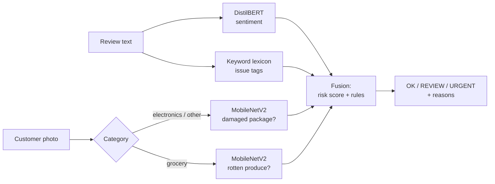

# Review Flagging

**Catch problem orders from what customers write, and what they show.**
The app reads a customer review (sentiment + issue tags), checks the customer's photo for a damaged package or
spoiled food, and combines both into one decision per order, **OK / REVIEW / URGENT**, with the reasons in plain English.

**Live demo:** https://review-flagging-ntu-b5ca07dcc853.herokuapp.com/


| Part | Model used on the site | Result on held-out test data |
|---|---|---|
| Review sentiment (negative / neutral / positive) | fine-tuned DistilBERT, 8-bit ONNX | macro-F1 **0.768** on 6,751 reviews |
| Damaged package in the photo | MobileNetV2 (transfer learning) | macro-F1 **0.839** |
| Rotten produce in the photo | MobileNetV2 (transfer learning) | macro-F1 **0.977** |
| Review + photo combined | risk score + rules | catches **90%** of problem orders vs 51% from the review alone (simulated orders) |

All models run on a CPU with ONNX Runtime: about 300 MB of RAM in total and well under a second per order.

---

## Run it on your computer

You need **Python 3.11** and git. The trained models are already in the repo, so there is nothing to train.

```bash
git clone https://github.com/Flaxxxy/application-of-text-qualification.git
cd application-of-text-qualification
python3.11 -m venv .venv
source .venv/bin/activate              # Windows: .venv\Scripts\activate
pip install -r requirements.txt
python -m app                          # then open http://127.0.0.1:5000
```

Pages: **Check an order** (one review + optional photo, with examples), **Batch** (a CSV of orders + optional ZIP
of photos), **History** (your own checks), **Results** (all model comparisons).

To check that everything works: `pip install pytest` and
`python -m pytest tests/test_app.py tests/test_fusion.py tests/test_issue_tags.py tests/test_inference_parity.py`
(the remaining tests need the training requirements).

## Use it from Python or the command line

```python
from PIL import Image
from src.fusion import flag_order

decision = flag_order("The box arrived crushed, I want a refund", "electronics", Image.open("photo.jpg"))
print(decision["status"])                        # e.g. URGENT
print([r["text"] for r in decision["reasons"]])  # why
```

```bash
# one order
python scripts/flag.py "Stopped working after two days" --category electronics
# many orders: CSV with order_id, category, review_text; photos named by order id (folder or ZIP)
python scripts/flag.py --csv demo_data/orders.csv --images demo_data/images --out flagged.csv
```

Categories: `electronics` and `other` (photo checked for package damage), `grocery` (photo checked for rot).

## Deploy your own copy

The repo is ready for **Heroku** (`Procfile`) and **Render** (`render.yaml`). The app needs about 300 MB of RAM,
so the smallest plans (512 MB) are enough.

**Render (free, no card; the site sleeps after 15 minutes without visitors)**
1. Fork this repo on GitHub.
2. On [render.com](https://render.com), sign in with GitHub → **New + → Blueprint** → pick your fork → **Apply**.
3. Wait for the build (about 5 minutes). Your address appears at the top of the service page.

**Heroku (Basic plan, $7/month; free for students with the GitHub Student Developer Pack credit)**
```bash
brew install heroku/brew/heroku        # or see devcenter.heroku.com/articles/heroku-cli
heroku login
heroku create your-app-name
heroku config:set SECRET_KEY=$(python -c "import secrets; print(secrets.token_hex(32))")
git push heroku main
heroku ps:type web=basic
heroku open
```
`SECRET_KEY` is optional; it keeps each visitor's History across restarts. The History itself is stored in SQLite on the
server's temporary disk, so it resets when the server restarts (about once a day on Heroku). That is fine for a demo.

## How it works



1. **Review.** A fine-tuned DistilBERT gives P(negative / neutral / positive). A regex lexicon finds issues
   (damaged packaging, wrong item, missing item, defective product, spoiled food, late delivery, refund request) and
   ignores negated ones ("the box was not damaged").
2. **Photo.** The category picks the model. MobileNetV2 (pre-trained on ImageNet, adapted to our photos) gives P(bad);
   the decision threshold was tuned to catch at least 90% of bad photos.
3. **Fusion.** `risk = 0.3·P(negative) + 0.4·P(bad photo) + 0.3·(issue mentioned)`, plus rules for when review and photo
   agree or disagree: negative review + bad photo → URGENT; happy review + bad photo → REVIEW; damage claimed but the
   photo looks fine → REVIEW (possible false claim); no photo → decision on the text only.

## Project layout

```
app/              Flask website (templates, CSS, a little JavaScript)
src/              all reusable code: data prep, models, evaluation, ONNX export, inference, fusion
models/deploy/    the ONNX models + tokenizer + settings used by the website (86 MB)
notebooks/        the analysis, in order: 01 text data → 02 text models → 04 image data → 07 fusion
                  (colab_* notebooks = GPU training on Google Colab)
results/          metrics.json, figures, predictions
demo_data/        12 example orders with photos
scripts/          data download, training runs, CLI, memory check, notebook generator
tests/            pytest (python -m pytest)
config.yaml       every setting and path in one place
```

## Retrain everything from scratch

You only need this to reproduce the training; the website runs without it.

1. **Environment.** `pip install -r requirements-train.txt` (includes PyTorch, TensorFlow, Transformers; a few GB).
2. **Keys.** Copy `.env.example` to `.env` and add a [Kaggle API token](https://www.kaggle.com/settings) and a
   [Roboflow API key](https://app.roboflow.com). `.env` is git-ignored.
3. **Data.** `python scripts/download_data.py --check`, then `python scripts/download_data.py text` and
   `... images --allow-large` (the fruit dataset is 3.6 GB). Amazon reviews are sampled from Hugging Face in random chunks;
   the full files are never downloaded.
4. **Text.** `python -m src.data_text` builds the balanced dataset; `python scripts/train_text_models.py` and
   `... bench` train and score the local and ready-made models. DistilBERT/RoBERTa fine-tuning runs on Colab:
   `python scripts/make_code_zip.py`, upload `code.zip` and `data/processed/text_*.csv` to `MyDrive/rrf/` on Google Drive,
   and run `notebooks/colab_03_finetune_text.ipynb` on a T4 GPU.
5. **Images.** `python -m src.data_images` cleans the photos and removes copies (SSCD copy detection); then
   `python scripts/make_images_zip.py`, upload `images.zip` + `code.zip`, and run `colab_05_image_packages` and
   `colab_06_image_produce`. Bring the files each notebook lists back into the same folders and run
   `python -c "from src.evaluate import import_colab_metrics; import_colab_metrics()"`.
6. **Export + fusion.** `python -m src.export_onnx` writes `models/deploy/`; notebook `07_fusion` builds the simulated
   orders and tunes the fusion weights; `python scripts/make_demo_data.py` rebuilds the examples.
7. **Check.** `python -m pytest` (all tests should pass) and `python scripts/check_memory.py` (peak RAM).

## Data and licences

| Data | Source | Licence | Used for |
|---|---|---|---|
| Amazon Reviews 2023 (Electronics, Grocery) | McAuley Lab, Hugging Face | research dataset | text train/test |
| Amazon review set | Kaggle `mehmetisik/amazon-review` | not stated | text train/test |
| Flipkart product reviews | Kaggle `niraliivaghani` | Open Database | text train/test |
| Customer Feedback | Kaggle `vishweshsalodkar` | see dataset page | external text test only |
| Damaged vs good packages | Roboflow `aadhavs-first-workspace` | CC BY 4.0 | package photos |
| BoxCondition | Roboflow `sih-yna9n` | CC BY 4.0 | package photos |
| Industrial quality control of packages | Kaggle `christianvorhemus` | GPL 2 | package photos (3D renders) |
| Fruits fresh and rotten | Kaggle `sriramr` | not stated | produce photos |

The datasets are not included in the repo (only 12 small example photos in `demo_data/`). Ready-made comparison models:
Cardiff RoBERTa, nlptown BERT, the default Hugging Face sentiment pipeline and OpenAI CLIP, all from Hugging Face.

## Limitations

- Sentiment labels come from star ratings, which are noisy (some "very bad" reviews are rated 3 stars).
- No public dataset has a review **and** a photo per order, so the combined result uses simulated orders that pair a
  test review with a test photo from a different customer.
- Package photos mix real cardboard photos, product shots and 3D renders; the model is weakest on the renders.
- The produce model knows apples, bananas and oranges only.
- 84% of the original fruit images were rotated or flipped copies; they were removed so the test scores are honest.

---

Course project, "AI in Accounting & Finance".
