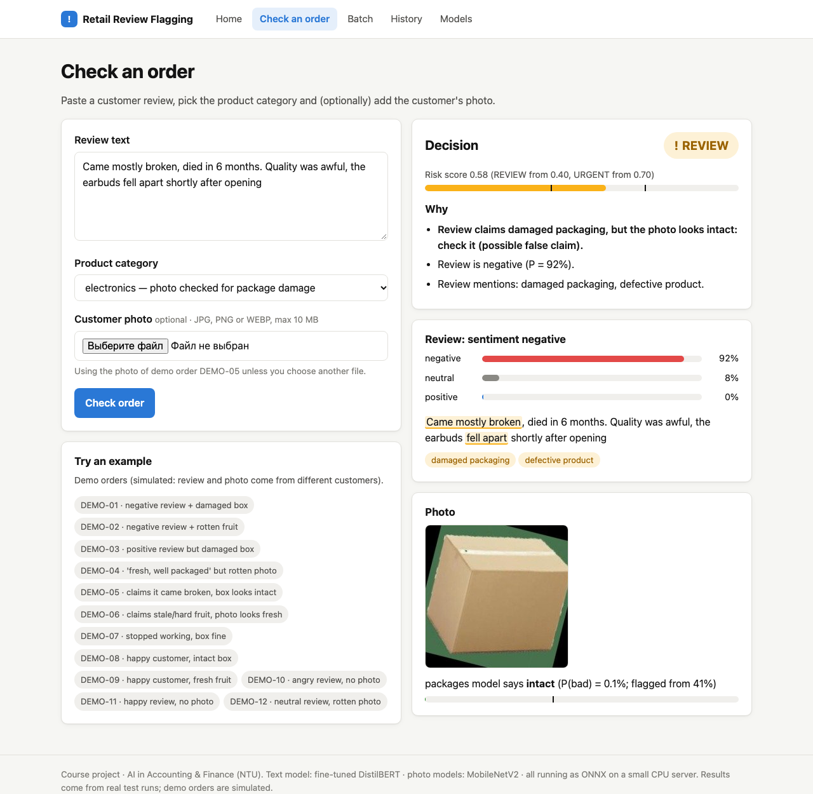

# Retail Review Flagging

Find problematic orders from what customers **write** and what they **show**. The tool reads a customer review
(sentiment + issue tags), checks the customer's photo for a damaged package or spoiled food, and combines both into
one decision, **OK / REVIEW / URGENT**, with the reasons spelled out.

Course project for "AI in Accounting & Finance" (NTU).

**Live demo:** https://review-flagging-ntu-b5ca07dcc853.herokuapp.com/ (Heroku Basic, 512 MB; the prediction history resets when the server restarts).



## Quick start (website)

Needs Python 3.11. Only the small app requirements are needed: the trained models are already in `models/deploy/`.

```bash
git clone https://github.com/Flaxxxy/application-of-text-qualification.git
cd application-of-text-qualification
python3.11 -m venv .venv && source .venv/bin/activate      # Windows: .venv\Scripts\activate
pip install -r requirements-app.txt
python -m app                                               # open http://127.0.0.1:5000
```

Pages: **Check an order** (one review + optional photo), **Batch** (CSV + ZIP of photos, or the 12 demo orders),
**History** (last 50 checks), **Models** (all results).

## Use it from Python or the command line

```python
from PIL import Image
from src.fusion import flag_order

decision = flag_order("The box arrived crushed, I want a refund", "electronics", Image.open("photo.jpg"))
print(decision["status"], [r["text"] for r in decision["reasons"]])
```

```bash
python scripts/flag.py "Stopped working after two days" --category electronics
python scripts/flag.py --csv demo_data/orders.csv --images demo_data/images --out flagged.csv
```

CSV format: `order_id, category, review_text` (categories: `electronics`, `grocery`, `other`); photos are named by
order id (`A-1001.jpg`), in a folder or a ZIP.

## Results (test data)

| Part | Model used | Result |
|---|---|---|
| Review sentiment (3 classes) | fine-tuned DistilBERT, 8-bit ONNX | macro-F1 0.768 on 6,751 reviews |
| Package photos | MobileNetV2 (transfer learning) | macro-F1 0.839 |
| Produce photos | MobileNetV2 (transfer learning) | macro-F1 0.977 |
| Review + photo combined | weighted score + rules | catches 90% of problematic orders vs 51% from the review alone (simulated orders) |

Full comparison (including ready-made models from Hugging Face and zero-shot CLIP) on the website's Models page and in
`notebooks/`. *A full write-up (architecture, datasets and licences, limitations, how to retrain) follows in the final phase.*

## Project layout

`notebooks/` the analysis in order (01 text data → 07 fusion) · `src/` all reusable code · `app/` Flask website ·
`models/deploy/` ONNX models used by the website · `results/` metrics and figures · `demo_data/` 12 demo orders ·
`tests/` pytest (`python -m pytest`).

To retrain everything you need the full requirements (`requirements-train.txt`), the Kaggle/Roboflow keys in `.env`
(see `.env.example`) and Google Colab for the GPU parts; see `PROGRESS.md` for every step.
